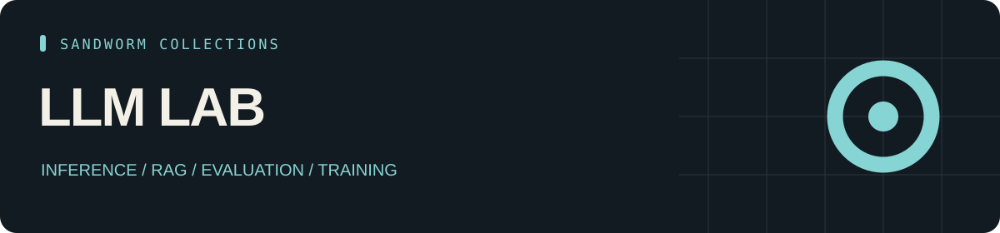

<p align="center"></p>

<p align="center"><b>49 skill entries · 15 tools · 24 source repositories</b></p>

# Sandworm LLM Lab

A practical LLM engineering lab: model serving, quantization, RAG, evaluation, training, and experiment observability.

ห้องทดลอง LLM สำหรับ serving, quantization, RAG, evaluation, fine-tuning และติดตามผลการทดลอง

[ภาษาไทย](README.th.md) · [Skills](CATALOG.md) · [Tools](TOOLS.md) · [Start here](docs/start-here.md) · [Sources](SOURCES.md) · [Collection hub](https://github.com/Sandworm-Lazarus/sandworm-arsenal)

## Original tool: Recorded Answer Evaluator

Authored implementation, documented inputs and synthetic regression fixtures. [Guide](docs/original-tool.md) · [Original work](ORIGINAL_WORK.md).

```bash
python3 scripts/eval_results.py --input examples/eval-cases.json
python3 -m unittest discover -s tests -v
```

## What is inside

| Track | Entries |
| --- | ---: |
| AI Engineering | 49 |

| Tool category | Projects |
| --- | ---: |
| Local inference | 4 |
| RAG & vector search | 3 |
| Training & fine-tuning | 2 |
| Observability | 2 |
| Model gateways | 1 |
| AI evaluation | 2 |
| AI application SDKs | 1 |

## Use the collection

Browse the pinned source links and use the task paths in [Start here](docs/start-here.md). The offline CLI requires Python 3.9+ and no third-party dependencies.

```bash
git clone https://github.com/Sandworm-Lazarus/sandworm-llm-lab.git
cd sandworm-llm-lab
python3 scripts/arsenal.py search "" --json
python3 scripts/arsenal.py tools "" --json
python3 scripts/arsenal.py stats
python3 scripts/arsenal.py check
```

On Windows, use `py -3` if `python3` is unavailable.

## Evidence and reuse

Entry and Overview labels retain the inspection scope from the original research. Tool records are README overviews. No upstream installation, runtime certification, or benchmark result is claimed. [Review coverage](docs/review-status.md) records this collection's counts.

Original summaries, artwork, CLI and guides are [MIT licensed](LICENSE). Linked projects retain their own licenses; inspect [source/license notes](SOURCES.md) before copying or deploying external packages. This collection contains original curation and links, not upstream bundles.

## Related collections

- [AI Toolbox](https://github.com/Sandworm-Lazarus/sandworm-ai-toolbox)
- [Agent Skills](https://github.com/Sandworm-Lazarus/sandworm-agent-skills)
- [Cyber Arsenal](https://github.com/Sandworm-Lazarus/sandworm-cyber-arsenal)
- [Dev Playbooks](https://github.com/Sandworm-Lazarus/sandworm-dev-playbooks)

Selections overlap where tools support multiple tasks. Do not add collection counts together to infer a unique total.
